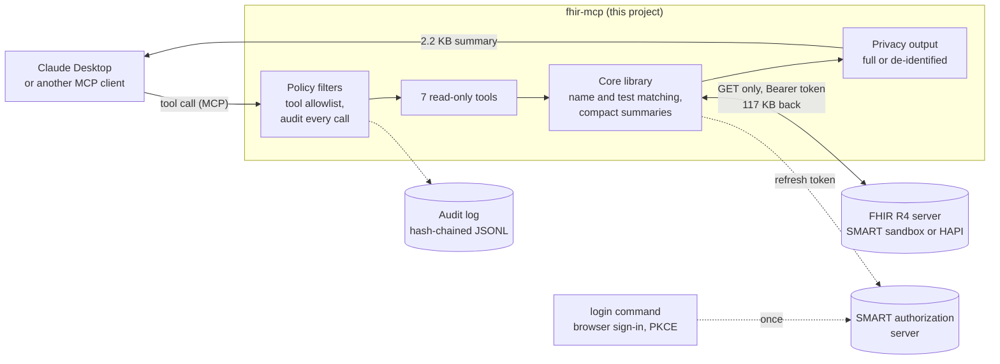

# FHIR MCP Server

An MCP server, written in C# on .NET 10, that lets Claude and other MCP clients answer questions about patient records over FHIR R4. Ask "What is Reyna Ziemann being treated for, and do her medications line up with it?" and the server runs the FHIR searches, trims the verbose responses down to what matters, and hands back a compact answer.

> **Synthetic data only.** This project points at public FHIR test servers seeded with synthetic patients. It is read-only and is not connected to any real patient data.

## Why this exists

Connecting an AI model to patient records over FHIR is a natural idea. Making it work well is harder than it looks, for two reasons.

**FHIR search is more literal than it looks.** The standard `name=` parameter matches only the beginning of one stored name value, so searching for "Reyna Ziemann" returns nothing: the phrase has to match one value from the start. "Sayed" misses "Al-Sayed" because "Al-" comes first. "a1c" misses "Hemoglobin A1c/Hemoglobin.total in Blood" because the test name does not start with "a1c". These are not bugs; they are how the standard works. But they matter a lot when a model generates search terms from natural language.

**Raw FHIR responses are large.** A patient summary takes six parallel searches and returns about 117 KB of JSON for one synthetic patient, much of it metadata and coding structure. Sending that to a model wastes context and produces worse answers.

This project addresses both: name and lab search are done on our side, with transparent notes about how results were found, and each tool returns a compact summary shaped for a model rather than for a client that needs the full resource. The MCP protocol connects it to Claude and other AI clients.

## Status

| Piece | State |
| --- | --- |
| FHIR client and patient search | Done |
| Name matching (full names, hyphens, accents, maiden names, fallback) | Done |
| MCP server with 7 read-only tools | Done |
| Patient summary, medications, conditions, encounters, observations, allergies | Done |
| Privacy and audit: tamper-evident audit log, de-identified mode, tool allowlist | Done |
| SMART on FHIR sign-in: PKCE, token refresh, read-only scopes, patient limit | Done |
| Model evaluation: 50 graded clinical questions, Claude and local MedGemma, full and de-identified | Built; first results pending |

## How it works



1. Claude turns a question into a tool call. **Policy filters** refuse tools that are not enabled and write an audit record for every call.
2. The **core library** asks the FHIR server narrow, read-only questions, matches names and test names the way a person types them, and flattens the large FHIR responses into small summaries.
3. **Privacy output** returns the summary as is, or de-identified, before it reaches the model.
4. With **sign-in** turned on, every FHIR request carries the signed-in user's token, renewed in the background. Sign-in itself happens once, from a terminal.

FHIR responses are large, which wastes the model's context and makes answers worse. Most of the work in this project is in shaping requests and responses, not in calling the API. Measured against the SMART Health IT sandbox for one synthetic patient:

| Question | Raw FHIR from the server | What the tool returns |
| --- | --- | --- |
| Patient summary (six searches) | 117 KB | 2.2 KB |
| Latest result of each lab test | 212 KB | 3.5 KB |

## Name search

FHIR's default name search surprised me in testing against public servers:

| Typed | FHIR server alone | This server |
| --- | --- | --- |
| `Reyna Ziemann` | 0 results (the phrase must match one name value) | Reyna Ziemann |
| `Sayed` (for Al-Sayed) | 0 results (only the start of "Al-Sayed" matches) | Fatima Al-Sayed, flagged as a looser match |
| `fatima al sayed` | 0 results | Fatima Al-Sayed |
| `Hammes` | Melony Williamson, with no hint why | Melony Williamson, showing "Melony Hammes (maiden)" |

How it works:

1. The server is asked about the most specific word typed (the longest), as a prefix, with hyphens kept.
2. Every word typed is then checked against all of each candidate's names: official, maiden, nickname. Case, accents, hyphens and apostrophes are ignored, so `arisso` finds Arissó and `obrien` finds O'Brien.
3. If nothing matches, the search is retried with FHIR's `:contains` modifier, and the result says so.
4. Each result lists the patient's other names, so it is clear why they matched.

Known limit: a name typed without its hyphen or apostrophe (`AlSayed`, `okeefe`) is not found, because the server stores "Al-Sayed" and "O'Keefe" and offers no way to match across those characters. The tool's description and its no-match note tell the model to use the stored spelling.

## Tools

| Tool | What it does |
| --- | --- |
| `search_patients` | Finds patients by any part of the name and/or birth date. Returns the id the other tools take, plus name, other names, gender, birth date, age, city, state, and a deceased flag. |
| `get_patient_summary` | One patient at a glance: demographics, active conditions and medications, allergies, the latest reading of each vital sign, and the last visit. Runs six searches in parallel. |
| `get_medications` | Medication orders, newest first, with status, dosage in plain words ("500 mg, twice a day"), reason, and RxNorm code. Active or all. |
| `get_conditions` | Problems and diagnoses with status, onset and resolution dates, and SNOMED CT code. Active (including recurrences and relapses) or all. |
| `get_encounters` | Visits and stays, newest first, with setting (ambulatory, emergency, inpatient), type, reasons, and discharge disposition. |
| `get_observations` | Labs, vitals, and other observations by category, test name, LOINC code, or date. `latestOnly` keeps the newest result of each test. |
| `get_allergies` | Allergies and intolerances with criticality and reactions. |

Tools are read-only and annotated as such. Errors (a bad date, an unknown patient, an unknown category) come back as messages the model can act on.

### Details that make the answers better

- **Readable values.** Synthetic data stores values like `77.92600836244159`; tools return `77.93 mg/dL`. Blood pressure reads `Systolic Blood Pressure: 124.7 mm[Hg]; Diastolic Blood Pressure: 81.68 mm[Hg]`, and coded answers read as text (`Never smoker`).
- **Test names found the way people say them.** Like names, FHIR's `code:text` search matches only the start of a test's full name, so `a1c` misses "Hemoglobin A1c/Hemoglobin.total in Blood" and `systolic` misses "Blood Pressure". When the server finds nothing, the tool scans the patient's recent results and matches words anywhere in the test name or its parts, and says it did.
- **References resolved in one request.** A medication order may point at a separate Medication resource instead of naming the drug. The tool asks the server to include those (`_include`) and returns the drug's name.
- **Honest notes.** Each list says when more items exist than were returned, and an empty allergy list says "none on file", not "no allergies".

## Privacy and audit

Three controls answer the first questions a security or compliance team asks about connecting a model to patient data. They are enforced once in the MCP request pipeline, so every tool is covered. The reasoning and the limits are in [decision 0006](docs/decisions/0006-privacy-and-audit-layer.md).

| Setting | Values | What it does |
| --- | --- | --- |
| `FHIR_MCP_AUDIT_LOG` | a file path, or `off` (default `~/.fhir-mcp/audit.jsonl`) | Writes one JSON line per tool call: time, tool, outcome, duration, arguments, patient ids accessed, item count, and the signed-in user when sign-in is on. Names and birth dates typed into a search are recorded as `[redacted]`. Each line holds the SHA-256 hash of the line before it, so edits are detectable. |
| `FHIR_MCP_PRIVACY` | `full` (default) or `deidentified` | De-identified mode follows the HIPAA Safe Harbor approach before anything reaches the model: patient names and cities removed, dates reduced to the year, ages over 89 shown as "90 or older". |
| `FHIR_MCP_TOOLS` | comma-separated tool names (default: all) | Tools not listed are hidden from the model and refused if called; refusals are audited. |

A real audit record from a test run (the client name is the test script):

```json
{"time":"2026-10-11T18:39:22.7563254+00:00","tool":"get_conditions","outcome":"ok","durationMs":190,"arguments":{"patientId":"76d2fa2d-66a6-4823-8dab-52cd70822844","status":"active"},"patientIds":["76d2fa2d-66a6-4823-8dab-52cd70822844"],"itemCount":7,"privacy":"full","client":"policy-check","previous":"1adb3cbb47e4537c60d0217c6ea57b1ef9f07376cd2940767f1620fe66c76cc5"}
```

Check that a log has not been edited:

```bash
dotnet run --project src/FhirMcp.Server -- audit-verify            # default log
dotnet run --project src/FhirMcp.Server -- audit-verify path/to/audit.jsonl
```

In de-identified mode, a search for Reyna Ziemann returns `"name": "[redacted]"`, no city, `"birthDate": "1974"`, and visit dates such as `"start": "2020"`. De-identified mode controls what the server sends to the model, not what you type: ask "tell me about Reyna Ziemann's medications" and the model already knows the name from your question, while the server's answer still carries no name and year-only dates. To see the difference, ask without a name (with sign-in limited to one patient, "summarize the patient I'm signed in for" works). Invalid settings (an unknown mode or tool name) stop the server at startup instead of falling back to a looser policy.

## Sign-in (SMART on FHIR)

Real FHIR servers require authorization. With `FHIR_MCP_AUTH=smart`, the server signs in as a person using [SMART App Launch](https://hl7.org/fhir/smart-app-launch/), the healthcare profile of OAuth 2.0, and reads only what that person was granted. It is off by default, so the open test servers keep working without it. The reasoning and the limits are in [decision 0007](docs/decisions/0007-smart-on-fhir-sign-in.md).

| Setting | Values | What it does |
| --- | --- | --- |
| `FHIR_MCP_AUTH` | `none` (default) or `smart` | Sends the signed-in user's access token with every FHIR request. |
| `FHIR_MCP_SMART_SCOPE` | default `openid fhirUser offline_access user/*.read` | What to ask for at sign-in. Only read scopes are accepted; anything that allows writing stops the server at startup. |
| `FHIR_MCP_SMART_CLIENT_ID` | default `fhir-mcp` | The client id sent to the authorization server. |
| `FHIR_MCP_TOKEN_STORE` | `keychain` (default on macOS) or `file` | Keychain: tokens in `~/.fhir-mcp/tokens.enc`, encrypted with AES-256-GCM under a key kept in the macOS Keychain. File: `~/.fhir-mcp/tokens.json`, readable only by you. |

**How it works.** The MCP server runs in the background with no terminal, so you sign in once from a terminal:

1. `login` reads the server's `.well-known/smart-configuration` and opens your browser to its sign-in page.
2. You sign in, choose a patient if asked, and approve. The browser hands the code back to the command on `http://127.0.0.1:<random port>/callback`.
3. The command trades the code for tokens using PKCE (S256), so an intercepted code is useless, and saves them.
4. The MCP server adds the access token to each request and renews it with the refresh token shortly before it expires, or once if the server rejects it. A sign-in made while it is running is picked up without a restart.

**Limited to one patient.** Ask for patient scopes and the sign-in page has you choose a patient. The session is then limited to that patient: the server refuses requests about anyone else before sending them, searches return only that patient, and each refusal is audited as `denied`. The FHIR server should enforce this too; checking here as well means the limit holds even against a server that does not (the SMART sandbox, for one).

**Try it on the SMART sandbox.** The `smart-login` server is the SMART launcher, which simulates an EHR's sign-in in front of the same synthetic patients. Choosing it turns sign-in on and asks for one patient's records (`launch/patient patient/*.read`); `FHIR_MCP_AUTH` and `FHIR_MCP_SMART_SCOPE` still override both. The long segment in its URL is the launcher's encoded settings: a provider signing in on their own, with PKCE required.

```bash
export FHIR_MCP_SERVER=smart-login

./src/FhirMcp.Server/bin/Debug/net10.0/FhirMcp.Server login         # pick any practitioner, then Reyna Ziemann, then Approve
./src/FhirMcp.Server/bin/Debug/net10.0/FhirMcp.Server auth-status   # who, which patient, when it expires (never the token)
./src/FhirMcp.Server/bin/Debug/net10.0/FhirMcp.Server logout
```

The sandbox's sign-in page is a demonstration: any password is accepted. `login` prints:

```
Signed in.
  User:          Practitioner/52919099-6a7a-442c-b0d5-2b02c0dd4b74
  Scope granted: openid fhirUser offline_access launch/patient patient/*.read
  Patient:       limited to 76d2fa2d-66a6-4823-8dab-52cd70822844
  Access token:  expires 2026-10-11 15:52; renewed automatically
```

Set `FHIR_MCP_SMART_SCOPE="openid fhirUser offline_access user/*.read"` before `login` to sign in without choosing a patient and read any patient the practitioner may see. To switch patients, run `login` again; the new sign-in replaces the old one, and a running server picks it up without a restart.

**In Claude Desktop.** Run `login` in a terminal with `FHIR_MCP_SERVER=smart-login` first, since tokens are saved per server, then set the same value in the server's `env`:

```json
"env": {
  "FHIR_MCP_SERVER": "smart-login",
  "FHIR_MCP_PRIVACY": "full"
}
```

Remove any `FHIR_BASE_URL` line when you add `FHIR_MCP_SERVER`: with both set the server will not start, and Claude Desktop shows it as disconnected (the reason is in `~/Library/Logs/Claude/mcp-server-fhir.log`). Fully quit (Cmd+Q) and reopen. Questions about the chosen patient are answered; a question about anyone else is refused and audited as `denied`.

Verified on macOS (Apple Silicon): browser sign-in, the Keychain key and encrypted token file, the one-patient limit in the terminal and in Claude Desktop, and de-identified mode on top of sign-in.

## Evaluation

The tests prove the tools return the right data. The evaluation measures whether a model reading that data answers correctly, so model, prompt and privacy choices can be made with numbers. It compares Claude with Google's [MedGemma](https://developers.google.com/health-ai-developer-foundations/medgemma), a medical model that runs locally, so patient data never leaves the machine. The design and its limits are in [decision 0008](docs/decisions/0008-model-evaluation.md).

- **50 questions about 5 synthetic patients** ([eval/questions.json](eval/questions.json)), across medications, allergies, conditions, labs, vital signs, visits, history and data that is not on file. Each expected answer was checked against the record, and a test proves that a correct reference answer passes every question.
- **Weighted by harm.** Medication and allergy questions count three times and are reported as critical misses. Any answer that names a medication not in the patient's record fails.
- **Two modes.** *Answer*: the patient's chart, frozen in [eval/context](eval/context), is in the prompt, which measures reading and makes runs repeatable. *Fetch*: the model gets only the question and calls this server's tools over MCP itself.
- **Both privacy modes.** De-identified runs use the server's own de-identification, so the report shows what Safe Harbor costs in accuracy (full dates are the expected casualty).
- **Graded by rules, not another model.** Required words, forbidden words, numbers within a tolerance, and yes or no first. Every failure is listed with the answer so a person can check the grading.

Run it (Claude needs `ANTHROPIC_API_KEY`; local models need [Ollama](https://ollama.com)):

```bash
ollama pull medgemma:27b && ollama pull medgemma1.5:4b
dotnet build
dotnet run --project src/FhirMcp.Eval -- run                          # Claude, MedGemma 27B and 4B; answer mode; full and de-identified
dotnet run --project src/FhirMcp.Eval -- run --models claude --modes fetch --privacy full
dotnet run --project src/FhirMcp.Eval -- run --models medgemma:27b --only reyna-active-meds,adolph-seizure-med
```

Each run writes `eval/results/<time>/report.md` (scoreboard, scores by category, every failure) and `results.jsonl` (every answer, tool call, timing and token count).

## Getting started

Requires the .NET 10 SDK.

```bash
dotnet build
dotnet test
```

Try a search from the command line (defaults to the SMART Health IT R4 sandbox):

```bash
dotnet run --project src/FhirMcp.Server -- search --name "reyna ziemann"
dotnet run --project src/FhirMcp.Server -- search --name ham --contains
```

Switch servers with `FHIR_MCP_SERVER` (`smart`, `hapi` or `smart-login`, described below), or point at any other FHIR R4 server with `FHIR_BASE_URL`. Setting both stops the server with an error, so it is always clear which one is in use. `servers` lists the choices and marks the current one:

```bash
FHIR_MCP_SERVER=hapi dotnet run --project src/FhirMcp.Server -- search --name sayed
dotnet run --project src/FhirMcp.Server -- servers
```

### Test servers

All three speak FHIR R4 (the version of the standard). They differ in who runs them, what data they hold, and whether you sign in.

| `FHIR_MCP_SERVER` | `smart` (default) | `hapi` | `smart-login` |
| --- | --- | --- | --- |
| URL | `https://r4.smarthealthit.org/` | `https://hapi.fhir.org/baseR4/` | `https://launch.smarthealthit.org/v/r4/sim/.../fhir/` |
| Run by | The [SMART Health IT](https://smarthealthit.org/) project | The [HAPI FHIR](https://hapifhir.io/) open-source project, as a public demo | The SMART Health IT project |
| Data | Curated synthetic patients generated by [Synthea](https://synthetichealth.github.io/synthea/), with realistic histories | Whatever anyone uploads; records vary widely and are often sparse | The same patients as `smart` |
| Sign-in | None | None | Simulated: practitioner, patient picker, approval (see [Sign-in](#sign-in-smart-on-fhir)) |
| Stability | Stable; patient ids stay valid | Data is added and cleared regularly; ids can disappear | Stable |
| Use it for | Demos and realistic questions (Reyna Ziemann is here) | Edge cases: hyphenated names, medications given by reference | Showing sign-in and the one-patient limit |

All hold test data only. Never send real patient information to either one; the HAPI server is publicly writable and anything stored there is visible to anyone.

### Connect it to Claude Desktop

Build once, then in Claude Desktop open **Settings > Developer > Edit Config** and add the server, using the full path to the built program (run `pwd` in the project folder to get it):

```json
{
  "mcpServers": {
    "fhir": {
      "command": "/Users/you/Projects/fhir-mcp/src/FhirMcp.Server/bin/Debug/net10.0/FhirMcp.Server",
      "env": {
        "FHIR_MCP_SERVER": "smart",
        "FHIR_MCP_PRIVACY": "full"
      }
    }
  }
}
```

To switch servers, change `smart` to `hapi` or `smart-login` (run `login` first for `smart-login`). Fully quit and reopen Claude Desktop. A full path is more reliable than `dotnet run`, because desktop apps on macOS do not always share the terminal's PATH.

### Connect it to Claude Code

Build once, then register the server. Use `-e` to choose the FHIR server:

```bash
# SMART Health IT sandbox (default, curated synthetic patients)
claude mcp add fhir -e FHIR_MCP_SERVER=smart -- /path/to/fhir-mcp/src/FhirMcp.Server/bin/Debug/net10.0/FhirMcp.Server

# HAPI public test server (edge cases: hyphenated names, medication references)
claude mcp add fhir -e FHIR_MCP_SERVER=hapi -- /path/to/fhir-mcp/src/FhirMcp.Server/bin/Debug/net10.0/FhirMcp.Server
```

Replace `/path/to/fhir-mcp` with the absolute path to this repo. To check what is registered:

```bash
claude mcp list
```

To remove and re-add with a different server:

```bash
claude mcp remove fhir
```

Once registered, ask Claude Code questions like: "Find Reyna Ziemann and summarize her health." or "Is her blood sugar trend improving?"

### Test it by hand

[MCP Inspector](https://github.com/modelcontextprotocol/inspector) gives you a web page to call each tool:

```bash
npx @modelcontextprotocol/inspector ./src/FhirMcp.Server/bin/Debug/net10.0/FhirMcp.Server
```

| Tool | Input | Expected |
| --- | --- | --- |
The main example patient is **Reyna Ziemann** (`76d2fa2d-66a6-4823-8dab-52cd70822844`): 7 active conditions including hypertension and prediabetes, 5 active medications, 10 allergies, 25 lab tests, and an A1c trend from 2014 to 2020.

| Tool | Input | Expected |
| --- | --- | --- |
| search_patients | name: `reyna ziemann` | 1 patient, Reyna Ziemann |
| search_patients | name: `Melony Hammes` | Melony Williamson, maiden name Hammes |
| search_patients | name: `o'keefe` | Mathilda and Clarine O'Keefe |
| get_patient_summary | Reyna's id | 7 conditions, 5 medications, 10 allergies, latest vitals, last visit 2020-05-27 |
| get_medications | Reyna's id, status: `active` | Hydrochlorothiazide, inhalers, ferrous sulfate, diphenhydramine |
| get_observations | Reyna's id, text: `a1c` | 5 results, 2014 to 2020, with a note that words were matched |
| get_observations | Reyna's id, category: `laboratory`, latestOnly: on | One result per test (25), including the lipid panel |
| get_observations | Reyna's id, category: `labs` | Error listing valid categories |
| search_patients | birthDate: `1/10/1953` | Error asking for yyyy-MM-dd |
| get_conditions | patientId: `../Patient` | Error saying the id is invalid |

Questions to try in Claude: "Find Reyna Ziemann and summarize her health." "Do her medications line up with her conditions?" "Is her blood sugar getting better or worse?" "Anything in her allergies to watch for?"

## Project layout

```
src/FhirMcp.Core      FHIR client, name matching, mapping, privacy and audit, SMART sign-in (no dependencies)
src/FhirMcp.Server    MCP server over stdio, policy filters, plus search, servers, audit-verify, login, logout and auth-status commands
src/FhirMcp.Eval      Model evaluation: question runner, Claude and Ollama clients, grader, report
tests/FhirMcp.Tests   xUnit tests with synthetic FHIR fixtures
eval                  Evaluation questions, frozen patient charts, and results
docs/decisions        Architecture decision records: why the code is shaped this way
```

## Design choices

The main decisions, with the options considered and their costs, are written up as [architecture decision records](docs/decisions/README.md). In short:

- **No dependencies in the core library.** The FHIR client uses `HttpClient` and `System.Text.Json` and reads only the fields it needs, which keeps the output shaping explicit and easy to test.
- **Read-only, bounded queries.** Every search requires real criteria and caps its results (50 at most), so a tool call can never page through a whole server.
- **Honest data.** Partial birth dates (`1955`) are not turned into exact ages, deceased patients get no current age, and looser matches are labeled as such.
- **Testable without a network.** Tests run against synthetic FHIR responses through a fake HTTP handler, and the clock is injected through `TimeProvider`. 191 tests cover mapping, name and test matching, request shape, limits, errors, the JSON each tool returns, de-identification, the audit log's hash chain, server selection, and sign-in (PKCE, discovery, token exchange and refresh, retry after 401, token storage, the patient limit) against a fake authorization server, plus the evaluation's grader, model clients and report.

## Security notes

- Read-only: the client only issues `GET` requests.
- Patient ids are checked against the FHIR id format before they go into a URL, so a malformed or injected value (`../Patient?_count=1000`) is rejected without a request.
- Paging only follows `next` links that point back at the configured server, so a response cannot steer the client to another host.
- Every tool call is audited, including refusals and failures, in a tamper-evident log (see Privacy and audit).
- SMART sign-in (optional) uses PKCE and a checked `state`, accepts only read scopes, keeps tokens encrypted at rest on macOS, and never prints them. See [decision 0007](docs/decisions/0007-smart-on-fhir-sign-in.md) for what it does not cover, such as revoking tokens at the server.
- Synthetic data only. The privacy controls here are a starting point, not a compliance program: do not point this at a server holding real patient data without sign-in turned on, protected storage for the audit log, and a review of free-text fields before relying on de-identified mode.
- Error messages returned to the model contain the server's diagnostic text, never stack traces or raw payloads. Logs go to stderr so they never mix with the MCP protocol on stdout.

## Roadmap

- Remote HTTP deployment on Azure Container Apps, with MCP's own authorization flow in place of the terminal sign-in
- An MCP prompt that assembles a visit summary from several tools
